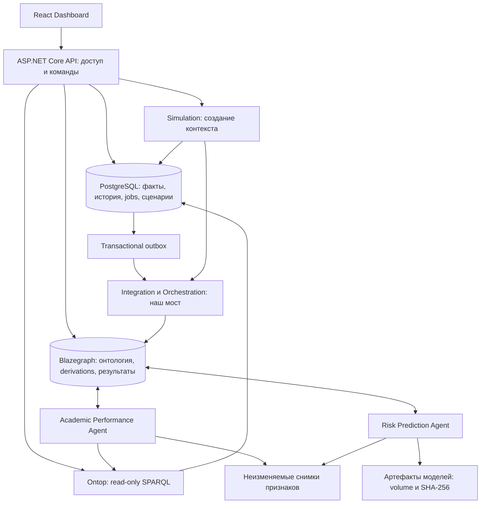
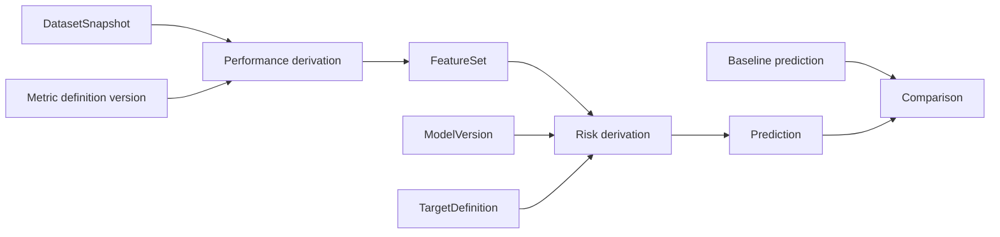

# Institute Digital Twin: исследование и архитектура

Дата исследования: 5 ноября 2026 года. Статус: проектное предложение, этап 1.

Исходное состояние: репозиторий `TheCollegeAvatar` содержит только `README.md` с названием проекта; рабочее дерево перед подготовкой документа чистое. Инфраструктура, модели и приложения отсутствуют. Этот документ не означает, что описанные компоненты развёрнуты или прошли интеграционные тесты. Примеры ниже — проектные контракты для последующей реализации.

## 1. Главные решения

Основой будет динамический граф знаний TWA: семантическая модель учреждения, зарегистрированные вычислительные агенты и зависимости результатов через Derived Information Framework. PostgreSQL хранит учебные факты и историю. Ontop предоставляет эти факты как виртуальный RDF. Blazegraph хранит материализованную часть графа: онтологию, вычислительные контексты, derivations и результаты. Прикладной API объединяет чтение из этих источников по общим IRI.

Для MVP предлагается ASP.NET Core как модульный прикладной API, Python для агентов и ML, React + TypeScript для интерфейса. Это два серверных runtime, но с чёткой границей: .NET отвечает за доступ и команды пользователя, Python — за вычисления. LLM в критическом пути нет.

Локальный запуск — собственная минимальная конфигурация Docker Compose с компонентами, используемыми TWA. Это **не полный TWA Stack Manager**. Stack Manager исследуем как эталон интеграции и последующий вариант развёртывания; не запускаем два менеджера над одними контейнерами. Реальная связь с TWA обеспечивается OntoDerivation и `pyderivationagent`, а не одним названием проекта.

Первый технический рубеж: доказать совместимость PostgreSQL → Ontop и Blazegraph ↔ Python/JVM ↔ derivation agent. До его прохождения нельзя обещать окончательный набор версий или работающий автоматический пересчёт.

## 2. Что существует в TWA, а что нужно разработать

Подтверждение доступности означает чтение публичной документации или исходного файла. Оно не означает успешную загрузку Docker-образа, установку пакетов или проверку их совместной работы.

| Компонент | Проверено по официальным источникам | Решение для проекта |
|---|---|---|
| Dynamic Knowledge Graph | TWA описывает граф RDF и вычислительных агентов, обновляющих его | Использовать как архитектурную основу; DKG — не отдельный устанавливаемый сервер |
| Stack Tools | Отдельный репозиторий `TheWorldAvatar/stack`, Stack Manager, Data Uploader и Stack Clients | Изучать конфигурации и избирательно использовать компоненты |
| Stack Manager | Документация перечисляет PostgreSQL/PostGIS, Ontop, Blazegraph и геосервисы, запуск через `stack.sh` | Полный стек избыточен для образовательного MVP; Compose оформляем самостоятельно |
| Base Library | Отдельный `TheWorldAvatar/baselib`, ранее JPS Base Lib | Использовать необходимые библиотеки, не копировать монорепозиторий |
| Python derivation agents | В `baselib/python_derivation_agent` есть `pyderivationagent`; документированы Flask/Gunicorn и мост `py4jps` к Java | Два первых вычислительных агента строим на этом пакете; контейнеру потребуется совместимая JVM |
| Derived Information Framework | Описывает происхождение и обновление зависимых результатов | Использовать для графа вычислительных зависимостей; SQL-события подключаем самостоятельно |
| OntoDerivation | Публичный OWL-файл содержит `versionInfo=1.10`, дату 14.09.2026 | Зафиксировать фактическую совместимую редакцию при интеграции; номер онтологии не является версией Python-пакета |
| Ontop | Официальная документация указывает 5.5.0; поддерживает PostgreSQL, OBDA/R2RML и OWL 2 QL | Кандидат версии, ещё не проверенный с выбранными образами TWA |
| Parallel Worlds | TWA описывает создание альтернативных миров через изменение копий данных и повторный запуск моделей | Жизненный цикл учебных сценариев и изоляцию реализуем сами; готовый универсальный Scenario API не подтверждён |
| Visualisation | `TheWorldAvatar/viz` — React/Next.js Visualisation Platform, развитие Visualisation Framework | Собственный React Dashboard для учебных процессов; TWA-ViP оставить для будущих карт/кампуса |
| Campus Ontology и учебные агенты | В исследованных источниках готовая реализация для наших требований не подтверждена | Разработать предметную онтологию, импортеры, метрики, модели и UI |

Архитектурное описание DKG и текущая организация компонентов подтверждены [профилем TheWorldAvatar](https://github.com/TheWorldAvatar). Состав инструментов — [Stack Tools](https://github.com/TheWorldAvatar/stack). Детали развёртывания и базовые сервисы — [Stack Manager](https://github.com/TheWorldAvatar/stack/blob/main/stack-manager/README.md).

Документация Stack Manager рекомендует 32 ГБ RAM для полного стека, описывает GitHub package credentials и предупреждает об ограниченной совместимости аутентификации Blazegraph с агентами. Поэтому RDF endpoint не будет доступен напрямую пользователям. Реальную потребность минимального Compose в памяти измерим на этапе 2; обещать её заранее нельзя. [Источник](https://github.com/TheWorldAvatar/stack/blob/main/stack-manager/README.md).

Java-библиотека также документирует доступ к Maven packages через GitHub credentials. Часть README продолжает ссылаться на старые пути монорепозитория; один проверенный старый путь Python derivation agent вернул 404. Используем новые репозитории и проверяем ссылки, а не переносим команды буквально. [Base Library](https://github.com/TheWorldAvatar/baselib), [Python derivation agent](https://github.com/TheWorldAvatar/baselib/tree/main/python_derivation_agent).

TWA Data Uploader предназначен для загрузки статических файлов и содержит примеры OBDA; это полезный образец, но не готовый обработчик изменений учебных транзакций. [Документация](https://github.com/TheWorldAvatar/stack/blob/main/stack-data-uploader/README.md).

Ontop превращает SPARQL в SQL, не переносит все строки в тройки и поддерживает ограниченный профиль OWL. В таблице совместимости `SERVICE` отмечен как неподдерживаемый: не строим федерацию с Ontop в роли координатора. Для MVP объединение двух запросов делает API. [Введение Ontop](https://ontop-vkg.org/guide/), [совместимость](https://ontop-vkg.org/guide/compliance.html).

TWA-ViP предлагает страницы, dashboards и геопространственные представления, но образовательные экраны всё равно потребуют разработки. Отказ от включения ViP в MVP — выбор интерфейса, не отказ от TWA. [Visualisation Platform](https://github.com/TheWorldAvatar/viz).

## 3. Компоненты и потоки данных



Стрелки показывают обращения и передачу данных, а не автоматическую доставку событий самим графом. Агенты читают задания и зависимости через DIF; наш мост явно создаёт вычислительный контекст и нужные derivations.

**Владение данными:**

| Данные | Канонический источник | Представление в других компонентах |
|---|---|---|
| Студенты, курсы, зачисления, занятия, оценки, посещения | PostgreSQL | Ontop отображает выбранные SQL views в RDF |
| Онтология и SHACL | Версионированные файлы Git | Загрузка в KG и проверка валидатором |
| Параметры сценария, snapshot manifest, jobs | PostgreSQL | KG хранит IRI контекста, типы и ссылки на версии |
| Зависимости агентов и состояние derivations | Blazegraph / DIF | Job Monitor получает нормализованную проекцию |
| Рассчитанные метрики и прогнозы | RDF-результат конкретного завершённого запуска | API читает KG; SQL не ведёт независимую редактируемую копию вероятностей |
| Матрицы признаков, снимки | Неизменяемые таблицы PostgreSQL в MVP | KG хранит идентификатор, hash и происхождение |
| Обученная модель, отчёт обучения | Файлы в persistent volume | `model_version` хранит hash, путь и метаданные |

Тонкие RDF-описания объектов, необходимых DIF, допустимы: тип, IRI, ссылка на snapshot. Копировать все оценки в Blazegraph не требуется. Общий Student IRI соединяет виртуальные факты и материализованные прогнозы. Это распределённый логический KG, а не обещание единого физического endpoint.

Обычные таблицы Dashboard можно читать через SQL для эффективности. Knowledge Graph Explorer должен действительно использовать SPARQL и показывать происхождение ребра: виртуальный факт, вычисление или гипотеза. Обход соседей ограничиваем глубиной, типами и количеством узлов.

## 4. Идентификаторы, время и воспроизводимость

Используем UUID как внутренние ключи. IRI формируются детерминированно, например `https://campus.example/id/student/{uuid}`. Это демонстрационный namespace; постоянный контролируемый домен выбирается до внедрения. ФИО, email и номер зачётной книжки в IRI не включаются. Для импорта есть уникальный внешний ключ `(source_system, source_key)` в отдельной таблице соответствий.

Стабильная сущность и её версия различаются: `.../student/{uuid}` — человек в модели, `.../grade-revision/{uuid}` — конкретная редакция оценки. Время хранится в UTC (`timestamptz`), учебный период имеет отдельный календарь и часовую зону учреждения.

Для исправляемых данных нужны два времени: когда факт действовал в предметном мире (`valid_from`, `valid_to`) и когда система знала эту редакцию (`recorded_at`, `superseded_at`). Для событий дополнительно `occurred_at`, для оценок — `available_at`, когда результат стал доступен для прогнозирования. Интервалы полуоткрытые `[from,to)`; NULL в конце означает открытый интервал.

Исправление оценки создаёт новую редакцию и закрывает предыдущую, а не удаляет историю. Перевод между группами представлен интервалами членства. Изменения расписания также версионируются. Запрос «что было известно на дату t» обязан учитывать время регистрации, иначе исправленная задним числом оценка попадёт в прошлое обучение.

Каждый расчёт привязан к `snapshot_id`, `as_of`, `knowledge_cutoff`, версии признаков, онтологии, кода и модели. `as_of` ограничивает учебные события, `knowledge_cutoff` — доступные к тому времени записи. Снимок создаётся в одной согласованной SQL-транзакции; чтение нескольких живых SPARQL-запросов само по себе такого снимка не даёт.

## 5. Предлагаемая SQL-схема

Ниже логическая схема, не готовые миграции. Во всех сущностях `id uuid PRIMARY KEY`, если отдельно не указан составной ключ. Ссылки `_id` — внешние ключи. Схемы: `core` для предметных данных, `analytics` для снимков и моделей, `scenario` для сценариев, `ops` для выполнения и аудита. SQL views в `semantic` отделяют публичную семантическую модель от внутренних таблиц.

| Таблица | Основные поля и ограничения |
|---|---|
| `core.institute` | `code UNIQUE`, `name`, `timezone` |
| `core.department` | `institute_id`, `code`, `name`; UNIQUE institute + code |
| `core.student` | `institute_id`, `pseudonym UNIQUE`, `source_ref_id`; реальные контакты в будущем отдельно |
| `core.teacher` | `department_id`, `pseudonym`, `source_ref_id` |
| `core.academic_group` | `department_id`, `code`, `cohort_year`; UNIQUE department + code + cohort |
| `core.group_membership` | `student_id`, `group_id`, интервалы действительности и регистрации; без пересечений основного членства |
| `core.subject` | `department_id`, `code`, `title`; дисциплина как каталог |
| `core.academic_period` | `institute_id`, `code`, `starts_on`, `ends_on`; start < end |
| `core.course` | `subject_id`, `period_id`, `code`, `planned_hours`; конкретное проведение дисциплины |
| `core.course_teacher` | `course_id`, `teacher_id`, `role`, интервалы; допускается несколько преподавателей |
| `core.enrollment` | `student_id`, `course_id`, `status`, интервалы; одно актуальное зачисление на пару |
| `core.lesson` / `lesson_revision` | стабильный ID; редакция: `course_id`, `starts_at`, `ends_at`, `status`, `teacher_id`, времена истории |
| `core.assessment` / `assessment_revision` | `course_id`, `due_at`, `max_score > 0`, `weight >= 0`, `kind`, история правил |
| `core.grade` / `grade_revision` | grade: `enrollment_id`, `assessment_id`, `attempt_no`; UNIQUE по тройке. revision: `score`, `status`, `available_at`, `recorded_at`, `superseded_at`, `source_batch_id` |
| `core.attendance_record` / `attendance_revision` | record: `enrollment_id`, `lesson_id`, UNIQUE пара. revision: `status`, `minutes_present`, `occurred_at`, времена истории |
| `core.intervention` | `student_id`, `course_id?`, `kind`, `planned_at`, `started_at?`, `ended_at?`, `status`, `approved_by`; факт поддержки, не обещание эффекта |
| `ops.source_reference`, `ops.import_batch` | внешние ключи источника, hash файла, версия схемы, ошибки, время и статус импорта |
| `analytics.snapshot` | `as_of`, `knowledge_cutoff`, `source_revision`, `schema_version`, `content_hash`, `created_at`, `status` |
| `analytics.snapshot_feature` | PK `(snapshot_id,enrollment_id,feature_version)`; mean_score, attendance_rate, trend, coverage, observation_count; после seal неизменяемая |
| `analytics.snapshot_input` | `(snapshot_id,entity_type,revision_id)` и при необходимости payload; фиксирует исходные редакции для повторной агрегации |
| `analytics.model_version` | `artifact_uri`, `sha256`, `algorithm`, `seed`, `feature_schema_version`, train/calibration/test boundaries, `code_commit`, `metrics_uri`, `status` |
| `scenario.scenario` | `baseline_snapshot_id`, `parent_scenario_id?`, `name`, `kind`, `created_by`, `created_at`, `status` |
| `scenario.parameter` | `scenario_id`, `target_iri`, `parameter_name`, `value`, `unit`, `schema_version`; UNIQUE scenario + target + name |
| `scenario.run` | `scenario_id`, `model_version_id`, `feature_version`, `code_commit`, `seed`, `input_hash`, `kg_context_iri`, `status`, start/end; результат доступен по KG IRI |
| `ops.outbox` | `event_id`, `aggregate_id`, `revision`, `event_type`, `payload`, `created_at`, `delivered_at`; создаётся в транзакции с фактами |
| `ops.job` | `run_id`, `agent_type`, `idempotency_key UNIQUE`, `attempt`, `status`, `lease_until`, `heartbeat_at`, `error_code`, `derivation_iri` |
| `ops.audit_event` | actor, action, resource, timestamp, outcome, correlation_id; без содержимого персональных карточек |

Ограничения между строками не маскируем под простой CHECK: соответствие курса у enrollment и assessment/lesson обеспечиваем составными FK либо проверкой в транзакции/триггером; `score <= max_score` проверяем против конкретной редакции assessment. Длительность посещения не превышает длительность занятия. NULL оценки означает отсутствие наблюдения, не ноль.

При расчёте успеваемости фиксируем политику пересдач и весов. Например, последняя доступная разрешённая попытка, нормализованная оценка `score / max_score`, среднее по весам опубликованных оценок. Отдельно показываем покрытие оценивания. Посещаемость: присутствовавшие минуты / учитываемые минуты состоявшихся занятий; отменённые исключаем, неизвестные отмечаем отдельно. При нулевом знаменателе результат NULL с причиной.

Индексы: все часто используемые FK, `(student_id,course_id)`, `(course_id,starts_at)`, `(recorded_at,superseded_at)`, `(snapshot_id,enrollment_id)`, `(status,lease_until)` для jobs. Непересечение актуальных интервалов — exclusion constraint или эквивалентная транзакционная проверка. Миграциями прикладной БД владеет один механизм — EF Core; агентам запрещено самостоятельно изменять схему.

## 6. Campus Ontology v0.1

Namespace: `https://campus.example/ontology/`. OWL описывает смысл классов и отношений; обязательность, диапазоны чисел и целостность проверяются SQL и SHACL. Наличие OWL-ограничения само по себе не заменяет валидацию входных данных. SHACL — стандарт проверки RDF-графов по формам ограничений. [W3C SHACL](https://www.w3.org/TR/shacl/).

| Класс | Основные отношения и значения |
|---|---|
| `Institute` | `hasDepartment → Department`, name, timezone |
| `Department` | `partOf → Institute`, `offersSubject → Subject` |
| `Student` | `hasEnrollment → Enrollment`, `hasMembership → GroupMembership` |
| `Teacher` | `affiliatedWith → Department`; назначения через `TeachingAssignment` |
| `AcademicGroup` | `managedBy → Department`, cohortYear |
| `Subject` | code, title; дисциплина без привязки к семестру |
| `Course` | `hasSubject → Subject`, `inPeriod → AcademicPeriod`, `hasTeachingAssignment → TeachingAssignment` |
| `Enrollment` | ровно один `student → Student`, один `course → Course`, status, validFrom/To |
| `Lesson` | `inCourse → Course`, startsAt, endsAt, status |
| `Assessment` | `inCourse → Course`, maxScore, weight, dueAt; Subject определяется через Course |
| `Grade` | `forEnrollment → Enrollment`, `forAssessment → Assessment`, attemptNumber; значения в `GradeRevision` |
| `AttendanceRecord` | `forEnrollment → Enrollment`, `forLesson → Lesson`; значения в `AttendanceRevision` |
| `AcademicPeriod` | startDate, endDate, `ofInstitute → Institute` |
| `Intervention` | `concerns → Student`, kind, status, validFrom/To; проведённая поддержка |
| `Prediction` | `concerns → Student`, `forEnrollment → Enrollment`, `inContext → ComputationContext`, `usesModel → ModelVersion`, probability, targetDefinition, horizon |
| `Scenario` | `basedOn → DatasetSnapshot`, `hasParameter → ScenarioParameter`, `hasRun → ComputationRun` |

Дополнительные классы: `GroupMembership`, `TeachingAssignment`, `FactRevision`, `DatasetSnapshot`, `Metric`, `FeatureSet`, `ModelVersion`, `ComputationContext`, `ComputationRun`, `ScenarioParameter`, `HypotheticalIntervention`. Последний не является фактом реально оказанной поддержки.

Прямые рёбра `Student → enrolledIn → Course`, `Student → belongsToGroup → AcademicGroup`, `Course → taughtBy → Teacher`, `Assessment → forSubject → Subject` — удобные проекции, вычисляемые из зачислений/назначений и временных views. Не делаем их вторым редактируемым источником. Не называем разные отношения одним универсальным `belongsTo`: это затрудняет ограничения и пересекается по смыслу с принадлежностью результата derivation.

Разделение происхождения: учебные редакции — `ObservedRecord` (в MVP дополнительно `synthetic=true`), метрики и Prediction — `DerivedResult`; результаты сценария имеют контекст `HypotheticalContext`. Прогноз baseline тоже вычисленный, а не наблюдаемый факт. Одному студенту соответствует общий IRI во всех мирах; результату — отдельный IRI, включающий run ID.

`Prediction` требует вероятность в [0,1], модель, целевой исход, горизонт и контекст; `GradeRevision` — неотрицательное числовое значение при статусе graded; attendance status — контролируемый словарь. `Scenario` требует один базовый snapshot. Отсутствие обязательных свойств — SHACL violation. Нельзя объявлять Student и Teacher непересекающимися: один человек может иметь обе роли.

Минимальный семантический фрагмент (не полный файл онтологии):

```turtle
@prefix c: <https://campus.example/ontology/> .
@prefix owl: <http://www.w3.org/2002/07/owl#> .
@prefix rdfs: <http://www.w3.org/2000/01/rdf-schema#> .

c:Student a owl:Class .
c:Enrollment a owl:Class .
c:Course a owl:Class .
c:student a owl:ObjectProperty ;
    rdfs:domain c:Enrollment ; rdfs:range c:Student .
c:course a owl:ObjectProperty ;
    rdfs:domain c:Enrollment ; rdfs:range c:Course .
```

Для Ontop выпускаем отдельный совместимый OWL 2 QL модуль Campus Ontology. Полную OntoDerivation с более выразительными конструкциями не передаём Ontop как будто она гарантированно поддерживается. В материализованном KG используем необходимые TWA-термины и provenance. Реальный namespace OntoDerivation — `https://www.theworldavatar.com/kg/ontoderivation/`; в исходном OWL присутствуют `belongsTo`, `isDerivedFrom` и классы derivations. [Исходный OWL](https://github.com/TheWorldAvatar/ontology/blob/main/ontology/ontoderivation/OntoDerivation.owl).

## 7. Конкретная связка SQL → RDF → SPARQL

Это спецификация демонстрации для этапов 2–3. Запросы здесь не выполнялись: базы и endpoints ещё не созданы. Нельзя принимать ожидаемый результат за результат теста.

Предположим, SQL view `semantic.enrollment_current` возвращает `id`, `student_id`, `course_id` для актуальных зачислений. В тестовом наборе одна строка:

| id | student_id | course_id |
|---|---|---|
| `00000000-0000-4000-8000-000000000101` | `00000000-0000-4000-8000-000000000001` | `00000000-0000-4000-8000-000000000201` |

Минимальный OBDA mapping использует документированный синтаксис `mappingId / target / source`. [Ontop Mapping Language](https://ontop-vkg.org/guide/advanced/mapping-language.html).

```text
[PrefixDeclaration]
c:      https://campus.example/ontology/

[MappingDeclaration] @collection [[
mappingId enrollment-current
target <https://campus.example/id/enrollment/{id}> a c:Enrollment ; c:student <https://campus.example/id/student/{student_id}> ; c:course <https://campus.example/id/course/{course_id}> .
source SELECT id::text AS id, student_id::text AS student_id, course_id::text AS course_id FROM semantic.enrollment_current

]]
```

SPARQL, который отправляется именно в Ontop:

```sparql
PREFIX c: <https://campus.example/ontology/>
SELECT ?enrollment ?course WHERE {
  ?enrollment a c:Enrollment ;
    c:student <https://campus.example/id/student/00000000-0000-4000-8000-000000000001> ;
    c:course ?course .
}
ORDER BY ?course
```

Ожидается одна строка с IRI enrollment, заканчивающимся `0101`, и IRI course, заканчивающимся `0201`. Ontop строит SQL на основе mapping и возвращает SPARQL Results JSON; triples заранее не загружаются в Blazegraph. Полноценный mapping дополнительно публикует Student, Course, GradeRevision и остальные классы.

Будущая проверка HTTP (адрес задаётся конфигурацией, путь не выдумываем):

```bash
curl --fail-with-body -X POST "$ONTOP_SPARQL_ENDPOINT" \
  -H 'Accept: application/sparql-results+json' \
  --data-urlencode 'query@queries/student-courses.rq'
```

Для совместного экрана API сначала получает зачисления из Ontop, затем делает ограниченный запрос в Blazegraph:

```sparql
PREFIX c: <https://campus.example/ontology/>
SELECT ?prediction ?probability WHERE {
  ?prediction a c:Prediction ;
    c:forEnrollment <https://campus.example/id/enrollment/00000000-0000-4000-8000-000000000101> ;
    c:inContext <https://campus.example/id/context/00000000-0000-4000-8000-000000000301> ;
    c:probability ?probability .
}
```

Endpoint Blazegraph выбирается сервером по разрешённому контексту. Если результатов нет, API возвращает «расчёт не выполнен», а не нулевой риск. Параметры IRI валидируются и сериализуются библиотекой, а не конкатенируются из произвольного пользовательского SPARQL.

Интеграционный критерий: SQL-count совпадает с SPARQL-count; изменение актуального зачисления видно в Ontop; повторная загрузка не создаёт дубликатов; computed predictions находятся по тому же enrollment IRI и нужному контексту. Отдельно проверяется исторический запрос к snapshot, а не только current view.

## 8. Агенты и Derived Information Framework

| Роль | Реализация | Вход → выход |
|---|---|---|
| Data Integration | Детерминированный импортёр и outbox worker | Синтетические записи → проверенные SQL-редакции, sealed snapshot, событие готовности |
| Academic Performance | Python `pyderivationagent` | DatasetSnapshot + MetricDefinitionVersion → Metric/FeatureSet |
| Risk Prediction | Python `pyderivationagent` + фиксированная ML-модель | FeatureSet + ModelVersion + TargetDefinition → Prediction |
| Simulation | Детерминированный сервис | Snapshot + параметры → отдельный контекст и повторный DAG вычислений |
| Intervention Analysis | Детерминированное сравнение | BaselineRun + AlternativeRuns → разницы прогнозов и ограничений |
| Orchestration | Небольшой координатор + DIF | События, контексты и зависимости → derivations, наблюдаемый статус jobs |

Роли не требуют шести отдельных микросервисов. В MVP достаточно API, двух derivation-agent процессов и одного общего worker для импорта/оркестрации/сценариев. Обучение модели — отдельная воспроизводимая команда или job, а не переобучение при каждой оценке. LLM-агенты не требуются.



DIF предназначен для отслеживания происхождения и распространения обновлений по вычислительным зависимостям. [Официальное описание](https://theworldavatar.io/features/derived-information-framework/). Документированный Python-интерфейс предполагает описание входных/выходных классов, валидацию и обработку запроса; он основан на Java derivation operations через `py4jps`. [README пакета](https://github.com/TheWorldAvatar/baselib/blob/main/python_derivation_agent/README.md). Конкретные методы клиента регистрации и обновления закрепим по исходникам выбранной версии, а не будем придумывать SDK.

**Протокол обновления, который пишем сами:**

1. Импортёр в одной SQL-транзакции записывает новые редакции фактов и outbox event. Проверка не прошла — нет частично опубликованного набора.
2. Worker забирает событие с lease, строит согласованный snapshot и фиксирует его manifest/hash. Для быстрого чтения агентами публикуется snapshot-specific SQL view/mapping или строго ограниченный SQL reader.
3. Мост создаёт в KG входную сущность DatasetSnapshot с RDF-типом и метаданными, необходимыми выбранному DIF. SQL row update сам по себе не обновляет timestamps DIF.
4. Создаётся новый контекст запуска и цепочка Performance → Risk. Ссылки на версии модели, определения метрик и целевого исхода входят в зависимости явно.
5. Агенты записывают результаты; координатор публикует завершённый run только после проверки наличия и валидности выходов. При необходимости API показывает старый run как устаревший, но не актуальный.
6. Для следующей SQL-редакции создаётся новый snapshot/run. Старый завершённый запуск остаётся неизменным. Перестановка указателя «последний успешный» разрешена лишь при более новой source revision.

Так DIF управляет вычислительным DAG, а наш координатор — заданиями пользователя, попытками доставки и жизненным циклом snapshot. Не создаём два конкурирующих планировщика одной derivation.

PostgreSQL и Blazegraph не разделяют транзакцию: используем доставку как минимум один раз, идемпотентность и периодическую сверку. Ключ job: hash(snapshot, scenario parameters, model version, feature version, agent version). Повтор после сбоя должен обнаружить уже созданную derivation/run. Если KG записан, а SQL-ack потерян, reconciler сверяет IRI и статус, не создаёт второй прогноз. Ошибки имеют стадии, число попыток и correlation ID; вечный retry запрещён.

В MVP завершённые результаты не пересчитываются «на месте»: это защищает историю от поведения DIF, которое может заменять зависимые outputs при обновлении. Для проверки механизма обновления DIF нужен отдельный тест на временном контексте. Поддержку namespace, регистрации агентов и схемы timestamps обязательно проверяем на выбранном пакете.

## 9. Parallel Worlds

TWA описывает параллельные миры как альтернативы базовому состоянию с изменёнными данными и повторными вычислениями. Это подтверждает принцип, но не заменяет проектирование изоляции и API нашего приложения. [TWA Technologies](https://theworldavatar.io/technologies/).

**Модель сценария:** неизменяемый baseline snapshot + типизированные изменения + фиксированные версии алгоритмов. Это не новая ветка живой БД с общими изменяемыми строками.

Для первого MVP выбираем feature-level сценарии, честно называя их анализом чувствительности условного прогноза. Baseline использует исходный FeatureSet. Alternative A увеличивает предположенную attendance_rate на 0.10, не выше 1. Alternative B — на 0.20, не выше 1. Остальные признаки, модель и выборка одинаковы. Исторические AttendanceRecord не переписываются; новый вектор — явно гипотетический. При наличии алгебраически зависимых признаков изменения пересчитываются согласованно или отклоняются.

Две альтернативы одного параметра позволяют проверить настоящий механизм сценариев без выдуманного коэффициента «допзанятие повышает оценку на N». При низком покрытии наблюдений или выходе за область обучающих признаков сценарий получает ограничение/отказ от расчёта. Не гарантируем снижение риска: результат определяется моделью.

Дополнительные занятия и изменение нагрузки — следующий уровень: нужны признаки реально оказанной поддержки и явная модель связи с будущими исходами. Если этих данных нет, выводим «эффект не оценён». Для расписания понадобится ресурсная модель преподавателей, аудиторий, конфликтов и нагрузки; это отдельная симуляция после MVP.

Порядок запуска:

1. Сохранить snapshot и baseline run с моделью M и target definition T.
2. Создать сценарий с baseline snapshot ID, автором, параметрами и их единицами.
3. Проверить диапазоны и допустимость преобразований; сохранить параметры до запуска.
4. Выделить отдельный вычислительный namespace Blazegraph для run, зарегистрировать необходимые TWA описания и входы. Одинаковые Student IRI допустимы, outputs получают уникальные IRI.
5. Повторно вычислить необходимые признаки и прогнозы в этом контексте. Векторы alternative храним отдельно от baseline.
6. Сравнить одинаковые enrollment ID, горизонт, модель и определения метрик. Разные версии модели помечать как несопоставимые для оценки одного вмешательства.
7. Публиковать baseline probability, scenario probability и разницу в процентных пунктах, параметры, версии, время и ограничения. Агрегаты считаются по одной и той же выборке; отсутствующие прогнозы не заменяются нулями.

Отдельный Blazegraph namespace выбран вместо предположения, что произвольный named graph автоматически изолирует внутренние запросы DIF. Такой вариант требует проверки конфигурирования агентов под контекст; при необходимости процессы запускаются с endpoint конкретного namespace. В MVP с baseline и двумя альтернативами это приемлемо. Многопользовательское масштабирование namespaces и worker pool — позднее.

Результаты защищаются не только RDF-контекстом: SQL-права worker запрещают изменение `core`; namespace выдаёт только сервер; исходные snapshot rows неизменяемы; публикация статуса после проверки; тесты сверяют hash baseline до и после сценария. Namespace сам по себе не является системой авторизации.

Термины UI: «условный прогноз при предположении», «сценарная разница». Термин «причинный эффект» недопустим без отдельно обоснованной причинной модели и данных. Intervention Analysis сравнивает прогнозы, но не автоматически назначает меры студентам.

## 10. ML и синтетические данные

Данные MVP: 100 вымышленных студентов, 4 группы, 6 предметов, например 8 преподавателей, 16 учебных недель одного синтетического семестра. Данные генерируются по опубликованным правилам с фиксированным seed, пропусками и шумом. Метрики качества описывают поведение на этом генераторе, не качество прогноза для реального института.

Цель первого прогноза: вероятность неудовлетворительного результата ближайшего контрольного оценивания по курсу в пределах следующих двух недель. Нормализованный проходной порог задаётся учебным правилом, например 0.60 для синтетической шкалы. Это конкретный академический исход, а не «вероятность отчисления» и не абстрактный риск.

Преимущество такого горизонта: временное тестирование возможно внутри одного семестра. Честно оценить перенос прогноза итогового результата семестра на будущие семестры по одному семестру невозможно. Для такой цели понадобятся дополнительные исторические периоды, хотя бы синтетические для проверки pipeline.

Первый baseline — константная вероятность из train. Основная модель — регуляризованная логистическая регрессия: несколько признаков посещаемости, успеваемости, тренда, покрытия и пропусков; без student ID как признака. Это небольшой воспроизводимый pipeline, а не набор LLM.

Временной протокол: train-примеры с доступными исходами не позднее недели 8; calibration/validation — с origin не раньше недели 9 и исходами не позднее недели 12; test — origins начиная с недели 13 с наблюдаемыми исходами до конца недели 16. Примеры, пересекающие границы по окну целевого исхода, исключаем. Для одной контрольной не создаём множество почти одинаковых строк с тем же target. Все preprocessing fit выполняются только на train, калибровка — на отложенном раннем блоке, test открывается после фиксации настроек.

Один студент может встречаться в разных временных блоках: это тест будущего поведения уже известных студентов. Это не доказательство переноса на новых студентов. Дополнительный анализ по удержанным группам/студентам полезен, но при 100 студентах будет неточным; зависимость наблюдений учитываем при оценке неопределённости.

Не включаем будущие оценки, финальные статусы, факты вмешательств после origin и сведения, зарегистрированные позже knowledge_cutoff. Отсутствие исхода не приравниваем к неуспеху. Split manifest содержит ID примеров, временные границы, target availability и причины исключения.

Отчёт: prevalence, PR-AUC, ROC-AUC только при наличии обоих классов, Brier score, log loss, calibration plot, размер выборки и пропуски. Если класс отсутствует — соответствующая метрика не определена. Не вводим произвольный проходной AUC. Сравниваем с константным baseline, проверяем воспроизводимость и валидность методики. При плохой калибровке показываем ограничение; sigmoid-калибровка допустима лишь при достаточном отдельном блоке данных. Калибровка и её метрики описаны в [scikit-learn](https://scikit-learn.org/stable/modules/calibration.html).

Объяснение — коэффициенты и вклады признаков в log-odds, с предупреждением об ассоциации. Неопределённость — cluster bootstrap по студентам для качества и устойчивости сценарной разницы; не называем диапазон между моделями гарантированным индивидуальным доверительным интервалом. Если данных мало, показываем «неопределённость надёжно не оценена». Проверяем ошибки и калибровку по группам/курсам с численностью; маленькие подгруппы не ранжируем. Для реальных данных потребуется отдельная проверка справедливости и пригодности.

## 11. Dashboard и прикладной API

| Раздел | Минимальное содержание |
|---|---|
| Overview | Численность, покрытие оценок/посещений, агрегаты, дата актуальности snapshot |
| Knowledge Graph Explorer | Поиск сущности, ограниченный обход, источник каждого ребра, текущий контекст |
| Academic Analytics | Метрики групп/курсов, динамика, знаменатели и пропуски |
| Student Profile | История учебных фактов, последние прогнозы, модель, горизонт, ограничения |
| Parallel Worlds Laboratory | Baseline + две альтернативы, параметры, status, сравнение, метка гипотезы |
| Agent Monitor | Очередь, агент, derivation IRI, попытки, heartbeat, ошибки и длительность |

Предлагаемые собственные endpoints (это **не TWA API**, а проект нашего приложения):

| Endpoint | Назначение |
|---|---|
| `GET /api/overview?periodId=...` | Агрегаты и freshness |
| `GET /api/students/{id}` | Разрешённая пользователю карточка |
| `GET /api/graph/neighbors?iri=...&contextId=...` | Ограниченный семантический обход |
| `POST /api/snapshots` | Создание неизменяемого снимка; асинхронный job |
| `POST /api/scenarios` | Snapshot ID, имя и валидируемые изменения |
| `POST /api/scenarios/{id}/runs` | Запуск с фиксированной modelVersion; Idempotency-Key |
| `GET /api/runs/{id}` | Состояние, provenance и ссылка на результаты |
| `GET /api/scenarios/{id}/comparison` | Сопоставление с baseline той же версии |
| `GET /api/agents/jobs` | Нормализованный мониторинг |

Долгие операции возвращают `202 Accepted` и job ID. Ошибки включают код, correlation ID и причину; пользователь не получает stack trace. OpenAPI фиксируется вместе с кодом; TypeScript-клиент генерируется из него. В MVP статус можно опрашивать, WebSocket не обязателен.

Роли: admin управляет настройками; преподаватель видит свои курсы и студентов; аналитик получает разрешённые агрегаты; оператор видит технические jobs без лишних персональных payload. Проверяется не только роль, но и принадлежность курса/группы. В MVP — только синтетические учётные записи и данные, но проверки доступа должны реально работать. Учётные записи и псевдонимы студентов не смешиваются.

Все endpoints SQL/SPARQL доступны только внутри Docker-сети. Браузер обращается к API. До подключения реальных данных нужны управляемая идентификация, изолированное хранение соответствия псевдонимов, аудит чтения карточек, политика хранения/удаления и правила минимального размера агрегатов. В API нет команды автоматического наказания, исключения или назначения негативных последствий по прогнозу.

## 12. Структура репозитория и версии

Предлагаемая будущая структура; сейчас создаётся только этот документ:

```text
TheCollegeAvatar/
  README.md
  docs/
    stage-1-architecture.md
    adr/                       # решения и проверенные компромиссы
    api/                       # OpenAPI
    evidence/                  # compatibility matrix, smoke-test reports
  infra/
    compose.yaml               # собственный минимальный Compose
    images.lock.yaml           # digest, upstream URL, архитектура CPU
    twa-stack/                 # адаптер развёртывания позже
    ontop/                     # mappings, QL-модуль, JDBC config без секретов
    blazegraph/                # параметры namespaces, init
  ontology/
    campus.ttl
    campus-ql.ttl
    shapes.ttl
    imports.lock.json
  src/
    api/                       # ASP.NET Core, auth, команды, чтение
    agents/
      common/                  # IRI, snapshots, provenance
      performance/
      risk/
      worker/                  # integration, scenario lifecycle, reconciliation
    web/                       # React + TypeScript
  database/
    migrations/
    views/
  ml/
    train/
    evaluation/
    model-cards/
  data/
    synthetic/                 # генератор и manifest, без реальных данных
  queries/                     # SPARQL-примеры и контракты
  tests/
    unit/
    semantic/
    integration/
    e2e/
  scripts/
```

Для .NET выбираем ветку 10 LTS, а patch/SDK фиксируем на этапе 2 по успешно собранному окружению. [Политика поддержки .NET](https://dotnet.microsoft.com/en-us/platform/support/policy/dotnet-core).

| Группа | Что фиксируем до первого принятого запуска |
|---|---|
| TWA | upstream commit для исследованных исходников; версии pyderivationagent, py4jps, Java/JAR и OntoDerivation; никаких подразумеваемых совпадений |
| Storage | PostgreSQL major/patch, Ontop image, Blazegraph image и параметры; JDBC driver; SHA-256 образов |
| Python | точный Python runtime и полный lock с хешами библиотек; отдельная совместимость ML и JVM bridge |
| API | `global.json`, NuGet lock, runtime image digest |
| Frontend | Node runtime и package lock для React/TypeScript и UI-зависимостей |
| Ontology | ontology version IRI, checksum imports, SHACL version |

Проверена публикация Ontop 5.5.0 в документации и OntoDerivation 1.10 в OWL, но они **не объявляются проверенной парой** с пакетами TWA. Точные версии остальных зависимостей пока не установлены. На этапе 2 формируем матрицу `candidate → installed → smoke passed → pinned`. Применение `latest` в воспроизводимом запуске запрещаем. Не требуется Git clone всего TWA; достаточно нужных пакетов, небольших файлов конфигурации и зафиксированных источников.

## 13. Дорожная карта и критерии приёмки

Оценка — для одного разработчика с уверенным Python/.NET и временем на освоение TWA: примерно 8–12 недель полной занятости после архитектуры, с резервом на интеграцию. Это план, не гарантированный срок. Для учебного проекта с частичной занятостью календарное время будет больше.

| Этап | Результат | Критерий завершения | Оценка |
|---|---|---|---|
| 1. Исследование | Этот документ, схема ответственности и проверяемые гипотезы | Определены собственные и TWA-компоненты, ограничения и дальнейшие проверки | Текущий этап |
| 2. Инфраструктура | Compose, healthchecks, версия каждого образа, smoke fixture | Чистый запуск; SQL → Ontop SELECT; Blazegraph read/write; минимальная реальная derivation в Python/JVM | 1–2 недели |
| 3. Данные и KG | Миграции, 100 студентов, онтология, mappings, SHACL | SQL/SPARQL parity; временная история; устойчивые IRI; повторный seed без дублей | 1–1.5 недели |
| 4. Агенты | Performance и первоначальный Risk-контракт, outbox, мониторинг | Два агента выполняют цепочку, ошибка/повтор не портит данные; сначала Risk может возвращать явно обозначенный rule baseline | 1–1.5 недели |
| 5. ML | Обученная логистическая модель, временной split, отчёт | Нет leakage; обучение воспроизводимо; истинные метрики измерены; Risk использует зафиксированный artifact | 1–1.5 недели |
| 6. Parallel Worlds | Baseline и две альтернативы, provenance | Изоляция baseline, стабильный повтор, сравнимые версии и одинаковая выборка | 1–1.5 недели |
| 7. Dashboard | Шесть минимальных разделов и API | UI использует реальные endpoints; прогнозы/ошибки/пустые данные показаны честно | 1–1.5 недели |
| 8. Проверка | Интеграционные/e2e тесты, runbook, backup/restore | Полный сценарий из чистого окружения повторён; данные сохраняются после restart | 1 неделя |

Этапы 4–5 разделены для проверки протокола агентов до ML; rule baseline не выдаётся за обученную модель. Все этапы включают свои тесты, этап 8 не является первым моментом тестирования.

Ключевые сквозные проверки:

- Синтетическая оценка меняется → outbox → новый snapshot → Performance → Risk; UI показывает новую source revision и сохраняет старую историю.
- Повтор события, остановка worker после записи KG и перезапуск не создают дополнительные логические результаты.
- Новый input/model version приводит к новому run; старый прогноз никогда не маркируется как вычисленный новой моделью.
- Значение вне допустимой шкалы или FK другого курса отклоняется до публикации.
- Запись, внесённая задним числом после cutoff, отсутствует в исторических признаках.
- Сценарий с дельтой 0 воспроизводит baseline в установленном числовом допуске; A/B не меняют hash фактов и baseline.
- Преподаватель другого курса не получает карточку через API, graph endpoint или run comparison.
- Остановка Ontop/KG видна как недоступность или устаревание, а не как пустая успешная аналитика.
- Полное восстановление PostgreSQL, Blazegraph и model volume сохраняет ссылки и повторяемость результатов.

До прохождения этапа 2 запуск всего MVP не считается технически подтверждённым. Если Python/JVM/DIF интеграция блокируется, сначала проверяем совместимую upstream-пару. Временно допустимый детерминированный job worker должен быть явно обозначен как временный режим без DIF, а не как готовая TWA-интеграция.

## 14. Риски и компромиссы

| Риск | Последствие | Мера |
|---|---|---|
| Документация TWA содержит старые пути | Неудачная сборка по буквальной инструкции | Проверка текущих отдельных репозиториев, версия и журнал воспроизведения |
| Доступ к registry/Maven и зависимости JVM | Блокировка ранней интеграции | Smoke test первым; credentials только через секреты; не обещать работу заранее |
| Blazegraph как долгосрочная зависимость | Ограничения сопровождения/обновления | Для MVP приоритет совместимости TWA; позже отдельная оценка Fuseki/RDF4J с полным набором DIF-тестов, не «drop-in замена» |
| Нет общей SQL/RDF транзакции | Частичная публикация, дубли | Outbox, идемпотентность, reconciliation, статус stale |
| Живой Ontop над изменяемым SQL | Невоспроизводимые сценарии | Явные snapshots и запрет live-read при повторе старого run |
| OWL-выразительность и ограничения Ontop | Неподдержанные запросы/аксиомы | QL-модуль, простые mappings, SQL views, контрактные SPARQL-тесты |
| Неизолированные внутренние запросы DIF | Пересечение разных миров | Namespace на контекст в MVP; проверить endpoint каждого агента |
| 100 студентов и один семестр | Шумная оценка и отсутствие внешней валидности | Короткий горизонт, временной split, честная отчётность, synthetic-only |
| Сценарная дельта воспринимается как причинность | Неверные решения | Явные предположения, отсутствие обещаний эффекта и автоматических санкций |
| Два backend runtime | Больше сборок и контрактов | Узкая роль .NET и Python, OpenAPI, общий протокол IRI/версий |
| Полный геостек/3D усложняет начало | Рост затрат без проверки учебной гипотезы | Отложить геосервисы и 3D; сохранить возможность расширения |

Следующее действие после отдельной команды — этап 2: минимальное окружение и проверка совместимости. Код приложений, миграции, контейнеры и ML в рамках этого этапа не создавались и не запускались.
